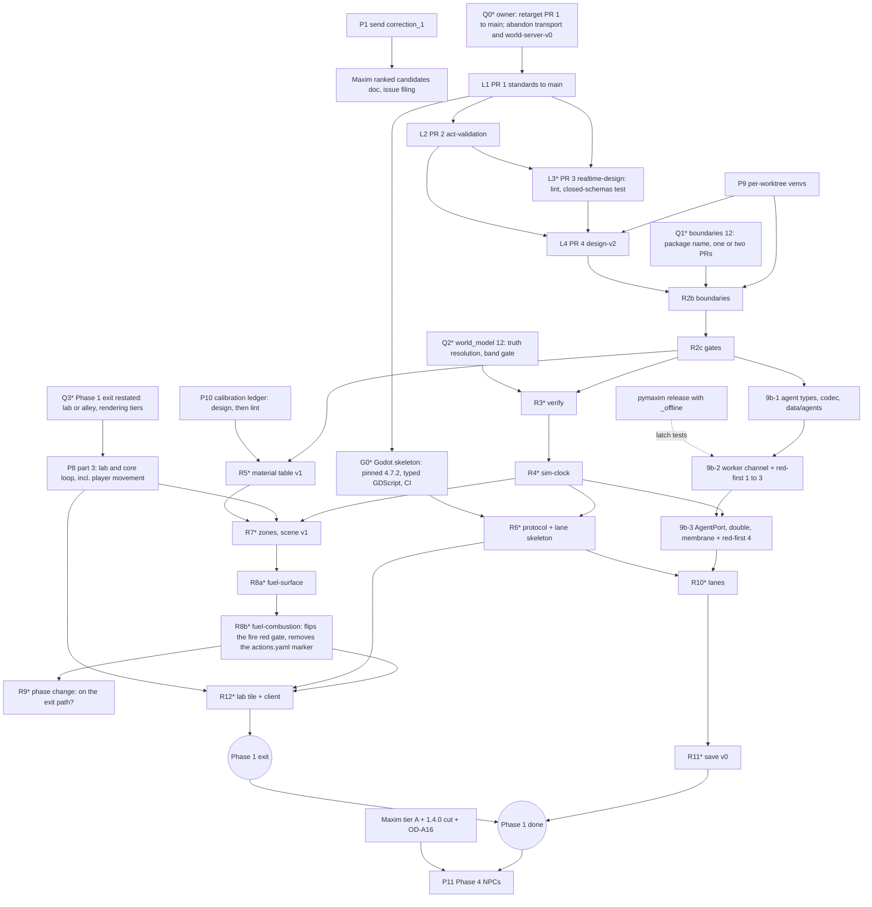

# Review of `foundations_plan.md` (72bf36c): the Sequencing lens

Reviewer: Sequencing. Read: the plan, `docs/roadmap.md`, `world_model.md` §10 and §12, `boundaries.md` §0, §10–§12,
`npcs_and_sem.md` §0, §6.2, §6.3, §12, `world_v2.md` §9, `phase1/realtime-design:docs/merge_notes.md`, the four
branches against `main`, the GitHub PR bases (`gh pr list`), `scripts/prepush.sh` and `.github/workflows/test.yml` on
`phase1/standards`, and Maxim `origin/main` `6fee7377` and tag `v1.3.3`. Conflicts were predicted read-only with
`git merge-tree --write-tree`. Nothing was edited and nothing written to git.

**Verdict.** §3 is a correct plan for the *agent foundations line* up to `phase1/gates`, but it isn't a plan for
Phase 1. It drops every PR between `phase1/gates` and the first visible tile, places `phase1/agents` before the clock
it needs, leaves out PR #3 although PR #3 carries gate code, and lands PR #1 into a branch that the design proposes
abandoning. It also omits five owner decisions that block step 5 or the exit test. 6 BLOCKER, 11 SHOULD-FIX, 8 NIT.

## 1. Facts the graph rests on (measured)

| Fact | Evidence |
|---|---|
| PR #1's base is `foundations/world-server-v0`, not `main`. PRs #2–#4 are based on `phase1/standards` | `gh pr list --json baseRefName` |
| `phase1/standards` contains all of `foundations/world-server-v0` (2 commits) and `phase1/transport` (1 commit) | `git rev-list` counts: 0 commits only on either |
| `main` is the initial commit. The gate's `BASE` is `main`, and CI's is `origin/main` | `prepush.sh:51-52`, `test.yml` `env: BASE` |
| act-validation and design-v2 fork from standards at `15bd3aa`. realtime-design forks earlier, at `9bad3bd` | `git merge-base` |
| standards ← act-validation: 1 conflict (`standards_backlog.md`, B21 vs B22 rows; trivial) | merge-tree |
| standards ← design-v2: **clean** | merge-tree |
| standards ← realtime-design: **5 conflicts**: `CLAUDE.md`, `code_review.md`, `standards_backlog.md`, `scripts/lint_standards.py`, `scripts/prepush.sh` | merge-tree |
| act-validation ← design-v2: `docs/roadmap.md` (Phase 3: act-validation's Maxim items 10 and 11 vs design-v2's OD- tables) | merge-tree |
| design-v2 ← realtime-design: 6 conflicts, 3 of them add/add (`realtime_lanes_coop.md`, its `determinism.md` review, `hybrid_1_5_line_DRAFT.md`), plus `roadmap.md`, `standards_backlog.md`, `lint_standards.py` | merge-tree |
| design-v2 is not docs-only: it adds `MARKER_EXEMPT_DIRS` to `lint_standards.py` and a test that review dirs may quote markers. realtime-design's merge notes say to drop both, because its lint refuses a directory exemption | `git diff 15bd3aa phase1/design-v2 -- scripts tests`; `merge_notes.md` |
| The shared `.venv` has no `importlinter`. No worktree has its own `.venv` | `import importlinter` fails; `ls .worktrees/*/.venv` is empty |
| Installed and CI pymaxim is 1.3.3 (PyPI, unpinned `>=1.3`). The offline latch `maxim/_offline.py` is on Maxim `origin/main` only (CHANGELOG `[Unreleased]`), not in `v1.3.3` | `pip show`; `git show v1.3.3:src/maxim/_offline.py` fails |
| `lint_standards.py` is 396 lines on standards. realtime-design adds +89/−5, and its `check_markers` has complexity 12 > 10 until it is merged with standards' split. Merged, the file is about 480 lines against the 500-line tripwire | `wc`, `ruff --select C901` |
| act-validation's `src/` passes the 40-line and 12-method tripwires that it predates | AST scan of `git archive phase1/act-validation` |

## 2. The dependency graph

Nodes: **P** are the plan's §3 steps, **R** are `world_model.md` §10 rows, **L** are landings, **Q** are owner
decisions and **G** is the Godot client. A solid arrow means "must finish before". The asterisks mark steps the plan
leaves out.

The same graph as a list, with each blocker and where it is stated:

| Node | Blocked by | Source of the edge |
|---|---|---|
| L1 PR #1 → `main` | Q0 (retarget), its gate PASS at the head handed over | GitHub base; `prepush.sh` BASE |
| L2 PR #2 | L1; the other session's hand-off | plan §3 step 3 |
| L3 PR #3 | L1, L2 (its merge notes put act-validation into realtime first) | `merge_notes.md` |
| L4 PR #4 | L2 (the roadmap conflict), L3 (the add/add docs, the lint exemption), P9 (its gate run) | merge-tree; `merge_notes.md` |
| R2b boundaries | L2 **merged** (it moves `parse_action`, `ActionLimits`, `checks`), L3 (it edits `prepush.sh` and the lint), L4 (the roadmap rows its TEMPORARY markers must be listed under), Q1, P9 (import-linter 2.15 needs a venv this worktree owns) | `boundaries.md` §10, §11.1, §12 |
| R2c gates | R2b | `boundaries.md` §11.1 |
| R3 verify | R2c ("before `phase1/verify`"), Q2 | `boundaries.md` §11.1; `world_model.md` §12 |
| R4 sim-clock | R3 | `world_model.md` §10 order |
| R5 material v1 | R2c (loaders and the content rule, B-5), the ledger if it should be born with provenance | `boundaries.md` §10 B-5 |
| R6 protocol | R4 (`observed_tick`, the integer tick), G0 (a Godot reader before the grammar freezes) | `world_model.md` §10 row 6 |
| R7 zones | R4, R5, P8 accepted (the lab's rooms are what zones are for) | `world_model.md` §10 |
| R8a, R8b fuel | R7; acceptance scenes vented + sealed (E1), which presume Q3 | `world_model.md` §10 |
| 9b agents | **R4** (the tick and the intent record), R2c | `npcs_and_sem.md` §6.2 "The PR's place"; `boundaries.md` §11.1; roadmap Phase 1 |
| R10 lanes | 9b, R6 (the lane skeleton) | `world_model.md` §10 row 10 |
| R11 save v0 | R10 | `world_model.md` §10 row 11 |
| R12 lab + client | R8b, R6, G0, P8 accepted | `world_model.md` §10 row 12 |

## 3. What can start today

Nothing below needs code from any branch:
- **P1:** send `correction_1.md` (owner).
- **Q0–Q3:** the owner decisions in SEQ-B3, B4 and B6. These cost no build time and sit on the critical path.
- **P9:** make a venv for this worktree, and record its pymaxim version (SEQ-S1).
- **P8:** draft part 3, `lab_and_core_loop.md`. It is a document and needs no code (SEQ-S2).
- **The calibration ledger's design note** (SEQ-S8).
- **L1:** as soon as Q0 is answered and the standards gate prints PASS at `87593fe`.

The Godot skeleton (G0) can start as soon as L1 lands. It touches only `client/` and CI, so it conflicts with nothing,
not even the rename.

## 4. The critical path to the first visible tile

Q0 → L1 → L2 → L3 → L4 → (Q1) R2b boundaries → R2c gates → (Q2) R3 verify → R4 sim-clock → R7 zones (needs R5 and P8)
→ R8a fuel-surface → R8b fuel-combustion → [R9, if bound water is on the path] → R12 lab + client → exit.

That is four landings (two owned by the other session), eight or nine serial code PRs, each with a full review round
and delta rounds, and four owner decisions. Off the path, and so parallel: R5 material v1 (beside R3 and R4), R6
protocol (beside R7–R8b, as long as G0 exists first), G0 (from L1 on), all of 9b, R10 lanes and R11 save v0. The
agent line is Phase 1 scope but **not** on the path to the exit test. §3 puts it first, which delays the tile without
shortening anything.

## 5. Findings

### BLOCKER

**SEQ-B1. §3 isn't a Phase 1 plan: it stops where the path to the tile begins.**
*Where:* `foundations_plan.md::§3`. *What:* the steps end at agents, part 3, venvs, the ledger and Phase 4. Ten of
`world_model.md` §10's rows are missing: verify, sim-clock, material v1, protocol, zones, fuel-surface,
fuel-combustion, phase change, lanes, save v0 and lab + client. So is the Godot client, which `CLAUDE.md` and roadmap
Phase 1 both name. `check_plan.py` can't catch the gap, because its sources exclude `world_model.md`. *Failure:* a cold
session finishes step 7 and the plan offers no next code step, or it invents one. The roadmap's exit test has no route
to it in the one document written so sessions can pick the work up cold. *Fix:* carry every §10 row in §3 with its
blockers (§6 below), and add `world_model.md` §10 to `check_plan.py`'s sources, so a dropped row fails the check.

**SEQ-B2. Step 7 (`phase1/agents`) is ordered before the clock it needs.**
*Where:* §3 step 7 says "blocked by step 6". *Against:* `npcs_and_sem.md` §6.2, "after `phase1/sim-clock` (it needs the
intent record and the tick)"; `boundaries.md` §11.1, "after sim-clock and before lanes"; `world_model.md` §10 (9b sits
after row 9); roadmap Phase 1, "after the clock". *Failure:* red-first test 4 ("resume at the modelled landing tick")
has no integer tick to resume at. The membrane's TEMPORARY marker can't be removed, because its replacement appends
to an intent log that sim-clock brings (B-9 "sim-clock (log)"). The PR either stalls or grows a private clock, which is
the band-aid the standards forbid. The plan says the linked document wins, but §3 is the table sessions act on. *Fix:*
step 7 is blocked by sim-clock. Under SEQ-S5's split, only 9b-1 and 9b-2 may start after gates.

**SEQ-B3. "Land PR #1" lands it into a branch the design proposes abandoning, and `main` never gets the source.**
*Where:* §3 step 2; §1 ("`main` has no `.gitignore` or source yet"). *What:* PR #1's GitHub base is
`foundations/world-server-v0`, and `boundaries.md` §11.3 and §12 Q3 propose abandoning that branch. *Failure:* after
step 2, `main` is still `d02c0a2`. The gate's `BASE=main` (CI: `origin/main`) keeps diff coverage measuring the whole
tree on every branch. The shared venv's editable install still points at an empty `src/`. §11.3's merge order has no
branch to merge into. *Fix:* a step 0 for the owner: retarget PR #1 to `main` (it already carries both
`world-server-v0` commits and `phase1/transport`), then answer Q3 (abandon both branches).

**SEQ-B4. Owner decisions that block step 5 and the physics PRs are missing.**
*Where:* §3 step 5 lists only steps 2–3; §5.1 lists only `npcs_and_sem.md` §12.1. *What:* `boundaries.md` §12 Q1 (the
engine package name: step 5 is a rename *into* that name, so it can't start without one), Q2 (one PR or two, which
decides whether step 6 exists), Q3 (abandoning branches, SEQ-B3), Q5 (frame cadence, which gates implement).
`world_model.md` §12 Q1 (the truth resolution, which verify and sim-clock are built on), Q2 (the band gate, which
the fuel PRs' acceptance uses) and Q3 (where the CSG footprints land). (The package-name point overlaps the
cold-start review; it is listed here because it is a node on the critical path.) *Failure:* the session reaches step 5
and stops, or picks `engine` and renames twice. *Fix:* list them as Q-nodes with the step each one blocks.

**SEQ-B5. PR #3 is missing from the order, and three documents give three different merge orders.**
*Where:* §3 (no step for PR #3); `boundaries.md` §11.3 (act-validation → standards → design-v2 → realtime-design);
`merge_notes.md` (act-validation into realtime-design, with design-v2 folded against realtime's lint). *What:* PR #3
isn't "docs, partly superseded". It changes the gate: a markdown-it marker lint, a new dev dependency, the preflight
import line in `prepush.sh`, and `tests/test_closed_schemas.py`, which its own notes say must be deleted when
act-validation lands. It conflicts with standards in five files, two of them gate scripts. *Failure:* boundaries
(which edits `prepush.sh` for `lint-imports` and adds TEMPORARY markers) branches before PR #3 lands. The other
session then rebases a lint and gate rewrite across the rename, or boundaries rebases across it. Either way the
conflicts are in the gate itself, and in a branch owned by another session. design-v2's `MARKER_EXEMPT_DIRS` and
realtime's test refusing directory exemptions can't both pass. *Fix:* one order, written in the plan and mirrored in
§11.3 and the merge notes: L1 standards → L2 act-validation → L3 realtime-design → L4 design-v2 → boundaries.
§11.3's "act-validation before standards" is impossible anyway, because act-validation is based on standards.

**SEQ-B6. The Phase 1 exit test can't be tested as written, so the critical path has no defined end.**
*Where:* roadmap Phase 1 "Exit"; `world_v2.md` §9 Q1; `world_model.md` D20, D23. *What:* under D20, rigs are rendering
tiers only and every machine runs one truth, so "look the same at the laptop and rig profiles" is vacuously true of
the simulation. It can now mean only a golden-screenshot comparison per rendering tier (B7). The tile itself is
open: the roadmap says the alley crate, D23 and world_v2 Q1 propose the lab's sealed and vented fires, and
`world_model.md` §10 E1 already accepts the fuel PRs on the lab version. "Walk into the alley" needs player movement
and a camera, which no row of §10 and no design owns. The player isn't an entity until Phase 5. *Failure:* the fuel
PRs are accepted against one scenario and the exit is judged against another. Or the last PR discovers that nobody
built locomotion. *Fix:* a Q3 owner decision restating the exit: the scenario, the rendering tiers compared by golden
screenshots, the human playtest. Give player movement to part 3 and R12.

### SHOULD-FIX

**SEQ-S1. Step 9 (per-worktree venvs) is a hard prerequisite of steps 4 and 5, not an independent step at position
9.** Boundaries pins `import-linter==2.15` and grimp 3.18, which the shared venv lacks. The standards forbid installing
into a shared venv, and `prepush.sh:45-47` dies with that message. The rename also changes the editable install's
package layout. The design-v2 worktree has no venv, so step 4's gate can't run either. Move step 9 to step 0. Record
each venv's pymaxim version: a new venv resolves `pymaxim>=1.3` from PyPI at creation time, so two worktrees can run
`tests/test_sem_compat.py` against different Maxims and disagree. Also check grimp 3.18 and import-linter 2.15 on
Python 3.14, which is in the CI matrix and the shared venv, before step 5 commits to the pin.

**SEQ-S2. Step 8 (part 3) is blocked the wrong way round.** The plan says part 3 waits for step 5. `world_model.md`
§10 row 2 says parts 1–3 must be accepted *before* 2b. Part 3 is a document and needs no code. Start it today. Then
either keep row 2 (and part 3 joins the critical path ahead of boundaries) or, as recommended, relax row 2 to "parts
1 and 2 accepted" for 2b and 2c, and make part 3's acceptance a blocker of zones (R7) and the lab (R12), the PRs that
actually read it. Fix whichever document is wrong.

**SEQ-S3. The Godot client has no step.** Roadmap Phase 1's first bullet and its exit both depend on it.
`world_model.md` §10 row 6 needs a Godot reader *before* the protocol grammar freezes, so a skeleton must exist before
R6: the pinned engine, typed GDScript with warnings as errors (B6), a headless import run in `prepush.sh` and in CI (the
CI matrix installs no Godot today), and a reader for one hand-written golden frame. For a team learning Godot this is
the riskiest unknown on the path, and it is free to run in parallel from L1 onward. Add it as G0.

**SEQ-S4. Step 5 depends on PR #2 being merged, not on step 3's "hand off".** Boundaries re-homes act-validation's
`parse_action`, `ActionLimits` and `checks`. If PR #2 changes during the owner's review after boundaries has branched,
a 25-file rename has to be rebased onto it. Boundaries also needs L4, whose roadmap holds the Phase 1 rows that the
marker lint requires for `TEMPORARY(phase1/agents)` and `TEMPORARY(phase1/sim-clock)`. Make boundaries a declared
serialization point: no other session starts a code branch from its start until it merges.

**SEQ-S5. `phase1/agents` is too large for one PR, and two of its parts have two owners.** As specified (npcs §6.2,
§6.6, world_model 9b, O19) it is: frozen types with golden fixtures, the codec, `data/agents/` loaders and gates, the
spawned worker with its environment allowlist and hash probe, the host thinking lane, the chunked speech stream and
syllable stamping, the scripted double, the membrane rewrite, the agent-step-path seal and the real-Maxim red gate.
Ownership contradictions:
- the **thinking lane** is in agents (npcs §6.2) and also in lanes (`world_model.md` §10 row 10);
- the **worker processes** are in agents (world_model 9b, O19, plan §3) and also in lanes (`boundaries.md` §11.1's last
  sentence).

Proposed split: **9b-1** types, codec (refuses pickle: red-first test 3) and `data/agents/` gates, after gates; **9b-2**
the worker channel and environment (red-first tests 1 and 2), after 9b-1; **9b-3** `AgentPort`, the double, the
membrane and the seal (red-first test 4), after sim-clock and 9b-2. The thinking lane goes to lanes. Fix the two
documents that disagree.

**SEQ-S6. Red-first test 5 can't fail in Overdrive.** "Credit shared among several traces, and trace expiry into the
wall-clock fallback" tests Maxim's NAc normalisation (`npcs_v3_1/determinism_bio.md` DB-B2). The scripted double has no
NAc, so against the double the test passes or fails by script, which is the vacuous test DB-B2 itself condemns. Its
home is Maxim, as the replacement for OD-EA12, or a strict red gate against real Maxim in 9b-3. Say which. As placed,
its exit can't be tested.

**SEQ-S7. A hidden Maxim release dependency in Phase 1.** O13's offline latch is `maxim/_offline.py`, which exists only
on Maxim `origin/main` (CHANGELOG `[Unreleased]`) and not in the installed and CI pymaxim 1.3.3. It is a private module,
so the declared-surface lint (B-2) should refuse a direct import; the public path is `MAXIM_OFFLINE` at `import maxim`.
Every 9b-2 test that engages or checks the latch waits on the next pymaxim release. Mark those tests as a strict red
gate naming the release, and raise the `pymaxim>=` floor when it ships. Separately, any 1.3.x release can turn every
branch's gate red through `test_sem_compat.py`; OD-A4 (A-pre) touches `SensorReading` stamping. Budget a mirror-update
PR and name its owner. With several worktrees, the first session to see it red shouldn't fix it in a feature branch.
Nothing else in Phase 1 waits on Maxim 1.3.x or 1.4.0. 1.4.0 and OD-A16 gate Phase 4 only.

**SEQ-S8. The calibration ledger (step 10) has no testable exit, and it is placed after what it should precede.**
"Proposed, not designed" means it needs a design note and a review before code, per the design-review standard. It
should land before material table v1 (R5), so the strict table is born with provenance rather than retrofitted. Its
lint will also push `lint_standards.py` (about 480 lines once #1 and #3 merge) over the 500-line module tripwire. Schedule
the split of that module as part of it, rather than discovering it as a red gate.

**SEQ-S9. Nothing says how a merged commit gets its PASS.** `merge_notes.md` requires `prepush: PASS` on every merged
commit. The gate refuses `main` and the main checkout, so the only routes are CI (which is exempt and says so) or a
detached worktree at the merge commit. State which one the owner uses. Otherwise the "after every merge" box can't be
ticked, or someone runs the gate on main with a bypass.

**SEQ-S10. Timing budgets under concurrent load need a method before the first budget lands.** §5.3 records gate time
rising from about 1 min to about 4 min at a load average of about 24. Gates (R2c: budgets) and sim-clock (memory
budget) add the first B5 gates. Decide CPU time, a minimum over N runs, or CI-only *before* R2c. A wall-time budget
written into the gate under today's load will flake, and the next session will be tempted to loosen it.

**SEQ-S11. The rebase conflicts in step 4 are design work, and the plan assigns none of it.** (1) In the roadmap's
Phase 3, act-validation adds two Maxim proposals, items 10 (malformed arguments booked as tool failures, against TF2)
and 11 (affordance direction, against `scene_actor_affordances.md`). Whoever merges second must map them onto OD- ids
(they read as parts of OD-C3, OD-C4 and OD-A16, which needs checking) or add new ids. A mechanical resolution would
lose two pushback items. (2) The three add/add docs shared with PR #3 must keep design-v2's newer versions. If PR #3
merges second, the other session resolves them, and "take theirs" silently reverts this line's folds. Assign both
resolutions to this line, at L4.

### NIT

- **SEQ-N1.** §1's states are stale: `origin/phase1/standards` is `87593fe`, not `e5aa3e1`. Local act-validation is
  8 commits ahead of its remote, and realtime-design 9.
- **SEQ-N2.** §1 calls PR #4 "docs only", but it changes `scripts/lint_standards.py` and `tests/test_lint_standards.py`.
- **SEQ-N3.** Step 4 is "blocked by step 2", but the rebase onto standards is clean today. What it waits for is
  standards' head being final, and L2 and L3 (SEQ-B5), not the owner's merge.
- **SEQ-N4.** Step 11 omits blockers: Phase 1's completion (lanes, the save line), OD-A16 (owner question 3), O14's
  six gates for guests, and Exp 64a's prerequisites OD-B1 to OD-B7. It cites "OD-A1 to OD-A18", which includes the
  moved OD-A13. The roadmap's Phase 4 cites "OD-A1 to OD-A19", which includes the withdrawn OD-A19.
- **SEQ-N5.** Roadmap Phase 1's "Save format v0: the world grid plus the scene spec" contradicts `world_model.md` row 11:
  after lanes, with in-flight thoughts.
- **SEQ-N6.** State whether R9 (phase change, bound water) is on the exit path. Wood moisture delays ignition, so the
  crate scenario may need it. If it doesn't, move it after R12.
- **SEQ-N7.** act-validation's strict red gate
  `test_the_fiercest_allowed_fire_has_the_same_outcome_at_every_rig_on_every_turn` is redefined by D20 (one truth).
  Name the PR that rewrites it: verify or sim-clock.
- **SEQ-N8.** `check_plan.py` is described as the plan's guard, but the gate doesn't run it, mypy and coverage don't
  reach it (it lives under `docs/`), and its sources skip `world_model.md` (D20–D25, §10, §12) and `boundaries.md` §12.

## 6. The corrected order

| # | Step | Blocked by | Owner | Parallel with |
|---|---|---|---|---|
| 0a | Retarget PR #1 to `main`; decide on abandoning `phase1/transport` and `world-server-v0` | nothing | owner | everything in 0 |
| 0b | Owner decisions: engine package name; one or two PRs; the truth resolution and band gate; restate the Phase 1 exit (lab or alley, rendering tiers, player movement) | nothing | owner | 0 |
| 0c | Send `correction_1.md` | nothing | owner | 0 |
| 0d | A venv per worktree, recording pymaxim; verify import-linter 2.15 on 3.14 | nothing | each session | 0 |
| 0e | Draft part 3 (`lab_and_core_loop.md`, with player movement and the exit scenario) → design review | 0b (the exit) | this line | 1–7 |
| 0f | Design note for the calibration ledger → review | nothing | this line | 1–7 |
| 1 | L1: PR #1 → `main` (PASS at the handed-over head) | 0a | owner | 0e, 0f |
| 2 | L2: PR #2 rebased on `main` → `main` | 1; the other session's hand-off | other session, owner | G0 |
| 3 | L3: PR #3 rebased on `main` (its merge notes) → `main` | 2 | other session, owner | G0 |
| 4 | L4: PR #4 rebased (drop the exemption, keep its newer docs, map items 10 and 11 to OD- ids) → `main` | 2, 3, 0d | this line, owner | G0 |
| G0 | Godot skeleton: pinned 4.7.2, typed GDScript, headless check in the gate and CI, one golden frame | 1 | this line | 4–9 |
| 5 | `phase1/boundaries` (a code freeze across sessions until it merges) | 4, 0b, 0d | this line | G0 |
| 6 | `phase1/gates`, with the B5 measurement method decided | 5 | this line | G0, 6L |
| 6L | Calibration ledger lint plus the split of `lint_standards.py` | 5, 0f | this line | 6, 7 |
| 7 | `phase1/verify` | 6, 0b | this line | 7M, 9b-1 |
| 7M | Material table v1 (strict, with provenance) | 6, 6L | this line | 7, 8 |
| 9b-1 | Agent types, codec, `data/agents/` gates (red-first 3) | 6 | this line | 7, 8 |
| 8 | `phase1/sim-clock` | 7 | this line | 9b-2 |
| 9b-2 | Worker channel and environment (red-first 1, 2; latch tests a strict red gate until the pymaxim release) | 9b-1 | this line | 8 |
| 9 | `phase1/zones` | 8, 7M, part 3 accepted | this line | 10, 9b-3 |
| 10 | `phase1/protocol` + lane skeleton + Godot fixture reader | 8, G0 | this line | 9, 11 |
| 11 | `phase1/fuel-surface` → `phase1/fuel-combustion` (flip the fire gate, remove the `actions.yaml` marker) | 9 | this line | 10, 9b-3 |
| 11P | Phase change (only if 0b puts bound water on the exit path) | 11 | this line | |
| 9b-3 | `AgentPort`, double, membrane, seal (red-first 4; test 5 rehomed) | 8, 9b-2 | this line | 9–11 |
| 12 | `phase1/lab`: the tile, player movement, the client drawing it → **the Phase 1 exit test** | 11, 10, G0, part 3 | this line | 13 |
| 13 | `phase1/lanes` (the thinking lane, barrier, meters) → save v0 | 9b-3, 10 | this line | 12 |
| 14 | Phase 4's first NPCs | Phase 1 done, tier A, 1.4.0 + the slice, OD-A16, OD-B1 to OD-B7 for Exp 64a | both | |

The order moves the agent line off the critical path without delaying it. 9b-1 and 9b-2 run during verify and
sim-clock, and 9b-3 runs during zones and fuel. It puts the four owner decisions, the venvs, part 3 and the Godot
skeleton at the front, because they cost the least and block the most.
